student at 42 and esgi, apprentice dev at a startup at station f.

## what i'm building

- [claude-accounts](https://github.com/LouisStani/Claude-Accounts): run several claude code accounts side by side, with one shared setup. bash. works, free, looking for users.
- drone: a 25 g quad running my own flight firmware, written in c by hand. step 0: picking the parts.
- container runtime: my own `docker run`, in c, written by hand. first step in progress.

## how i work

most of my code is written with claude code. i do the architecture, the big decisions, the ui and the users.
the drone and the runtime are the exception: i write that c myself.
